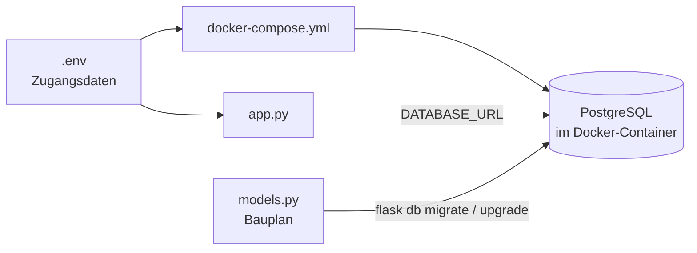

# Datenbank-Setup

Zurück zur [[00 Übersicht]] · siehe auch [[Datenmodell]], [[extensions.py erklärt]]

## Wie alles zusammenhängt



- `.env` enthält Benutzer, Passwort und Datenbank-Name. Die Datei wird von **beiden** Seiten gelesen: von Docker und von der App.
- `docker-compose.yml` startet PostgreSQL und legt beim **ersten** Start Benutzer und Datenbank an.
- `app.py` verbindet sich über `DATABASE_URL`.
- `models.py` wird über Flask-Migrate zu echten Tabellen.

## 1. docker-compose.yml

```yaml
services:
  db:
    image: pgvector/pgvector:pg17
    container_name: pea_postgres
    environment:
      POSTGRES_USER: ${POSTGRES_USER}
      POSTGRES_PASSWORD: ${POSTGRES_PASSWORD}
      POSTGRES_DB: ${POSTGRES_DB}
    ports:
      - "5432:5432"
    volumes:
      - pea_pgdata:/var/lib/postgresql/data
    restart: unless-stopped
volumes:
  pea_pgdata:
```

- `pgvector/pgvector:pg17` ist PostgreSQL 17 mit pgvector. Das wird später für Embeddings in `documents` gebraucht.
- `${...}` bedeutet: Der Wert kommt aus der `.env`.
- Das Volume `pea_pgdata` sorgt dafür, dass die Daten auch nach `docker compose down` erhalten bleiben.

## 2. .env

```env
POSTGRES_USER=pea_app
POSTGRES_PASSWORD=<geheimes Passwort>
POSTGRES_DB=pea_db

DATABASE_URL=postgresql+psycopg://pea_app:<geheimes Passwort>@localhost:5432/pea_db
```

> [!warning] Passwort an zwei Stellen
> Das Passwort steht in `POSTGRES_PASSWORD` **und** in `DATABASE_URL`. Wenn du es änderst, musst du beide Stellen ändern.

> [!warning] Nur beim ersten Start
> Docker legt Benutzer und Passwort nur beim **allerersten** Start an. Wenn du das Passwort später änderst, musst du `docker compose down -v` und dann `docker compose up -d` ausführen. ⚠️ Dabei werden alle Daten gelöscht.

- `.env` steht in `.gitignore` und kommt **nie** in Git.
- `.env.example` ist die Vorlage mit Platzhaltern und kommt in Git.

### DB-Benutzer ≠ App-Admin

| | DB-Benutzer `pea_app` | App-Admin |
|---|---|---|
| Wo | `.env` / PostgreSQL | Zeile in der Tabelle `users` |
| Wer nutzt ihn | das **Programm** | ein **Mensch** in der App |
| Vergleich | Schlüssel zum Aktenschrank | Mitarbeiterausweis in einer Akte |

## 3. Einrichtung Schritt für Schritt

```powershell
docker compose up -d                       # Datenbank starten
pip install -r requirements.txt            # Pakete (im .venv)
flask db init                              # nur einmal: migrations/ anlegen
flask db migrate -m "Initiale Tabellen"    # Migration aus models.py erzeugen
flask db upgrade                           # Migration in der DB ausführen
```

Prüfen, ob die Tabellen da sind:

```powershell
docker exec -it pea_postgres psql -U pea_app -d pea_db -c "\dt"
```

## 4. Admin-User anlegen

```powershell
flask shell
```

```python
from extensions import db
from models import User

admin = User(name="Elvir", email="info@mak-ev.de", role="admin")
db.session.add(admin)
db.session.commit()

User.query.filter_by(role="admin").first().email   # prüfen
```

- `add()` legt den Eintrag in den Warenkorb, `commit()` speichert ihn wirklich.
- Bei `UniqueViolation ... email` existiert der Admin schon. Danach `db.session.rollback()` ausführen.

> [!note] Noch kein Login
> `users` hat noch kein Passwort-Feld. Für einen Login kommen später Flask-Login und `password_hash` dazu. Danach wieder `migrate` und `upgrade` ausführen.

## 5. Datenbank ansehen

**PyCharm Professional:** Fenster *Database* → **+** → *Data Source* → *PostgreSQL*

| Feld | Wert |
|---|---|
| Host | `localhost` |
| Port | `5432` |
| User | `pea_app` |
| Password | aus `.env` |
| Database | `pea_db` |

Der Weg im Baum ist dann `pea_db → schemas → public → tables`. Mit einem Doppelklick öffnest du eine Tabelle.

**Kostenlose PyCharm-Version:** DBeaver oder das Plugin *Database Navigator* nutzen. Die Werte sind dieselben.

> [!tip] Unterschied zu SQLite
> SQLite ist eine Datei. PostgreSQL ist ein Server, deshalb muss der Container vorher laufen.

## Spickzettel

| Was | Befehl |
|---|---|
| DB starten | `docker compose up -d` |
| DB stoppen (Daten bleiben) | `docker compose down` |
| Alles löschen inkl. Daten ⚠️ | `docker compose down -v` |
| Status | `docker compose ps` |
| SQL-Konsole | `docker exec -it pea_postgres psql -U pea_app -d pea_db` |
| `models.py` geändert | `flask db migrate -m "..."` und danach `flask db upgrade` |
| Migration rückgängig | `flask db downgrade` |
| App starten | `flask run` |

## Häufige Fehler

| Fehler | Ursache | Lösung |
|---|---|---|
| `connection refused` | Container läuft nicht | `docker compose up -d` |
| `port is already allocated` | Ein anderes Postgres belegt 5432 | Port auf `5433:5432` ändern und `.env` anpassen |
| `relation "users" does not exist` | Tabellen fehlen | `flask db upgrade` |
| `password authentication failed` | Passwort nach dem ersten Start geändert | `docker compose down -v` und dann `up -d` |
| `KeyError: 'DATABASE_URL'` | `.env` fehlt | `.env` aus `.env.example` anlegen |
