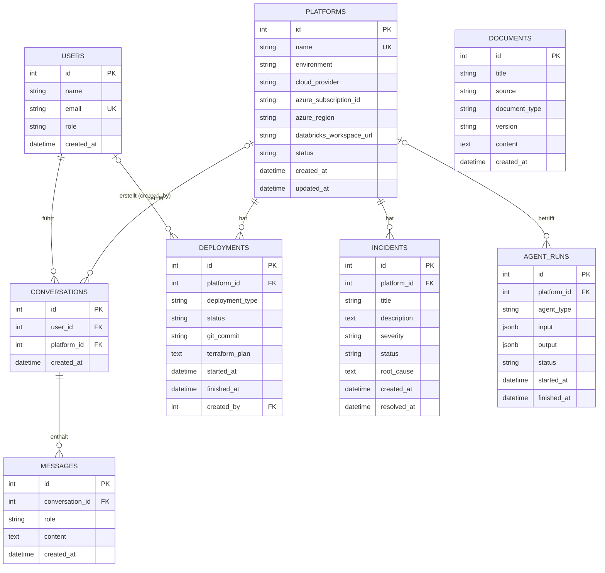

# Datenmodell

Zurück zur [[00 Übersicht]] · siehe auch [[Datenbank-Setup]]

## Beziehungen

## Tabellen

| Tabelle | Zweck | Wichtig |
|---|---|---|
| `users` | Menschen, die die App nutzen | `email` ist eindeutig; es gibt noch kein Passwort-Feld |
| `platforms` | Azure-/Databricks-Umgebungen | `name` ist eindeutig; beim Löschen werden Deployments und Incidents mitgelöscht |
| `deployments` | Terraform-Deployments einer Plattform | `created_by` ist optional |
| `incidents` | Störungen einer Plattform | `root_cause` wird nach der Analyse ausgefüllt |
| `documents` | Wissensbasis (Runbooks, Doku) | später `embedding` mit pgvector |
| `agent_runs` | Läufe von KI-Agenten | `input`/`output` sind JSONB |
| `conversations` | Chat-Verläufe eines Users | optional an eine Plattform gebunden |
| `messages` | einzelne Chat-Nachrichten | beim Löschen einer Conversation werden sie mitgelöscht |

## Erlaubte Werte

Diese Werte sind in `models.py` als Konstanten festgelegt. Die Prüfung soll später in der API passieren.

| Feld | Werte | Standard |
|---|---|---|
| `users.role` | `admin`, `platform_engineer`, `viewer` | `viewer` |
| `platforms.environment` | `dev`, `test`, `prod` | – |
| `platforms.status` | `healthy`, `degraded`, `down`, `unknown` | `unknown` |
| `deployments.status` | `planned`, `approved`, `running`, `succeeded`, `failed` | `planned` |
| `incidents.severity` | `low`, `medium`, `high`, `critical` | `medium` |
| `incidents.status` | `open`, `investigating`, `resolved` | `open` |
| `agent_runs.status` | `running`, `succeeded`, `failed` | `running` |
| `messages.role` | `user`, `assistant`, `system`, `tool` | – |

## Offene Punkte

- [ ] `users`: Feld `password_hash` für den Login ergänzen
- [ ] `documents`: Feld `embedding = db.Column(Vector(1536))` mit pgvector ergänzen
- [ ] Erlaubte Werte in der API prüfen
