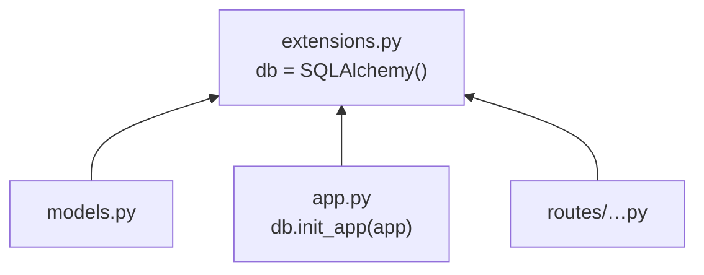

# extensions.py erklärt

Zurück zur [[00 Übersicht]] · siehe auch [[Datenbank-Setup]]

> [!summary] Merksatz
> **`extensions.py` erzeugt die Werkzeuge. `app.py` schließt sie an die App an. Alle anderen Dateien benutzen sie.**

## Inhalt

```python
from flask_migrate import Migrate
from flask_sqlalchemy import SQLAlchemy

db = SQLAlchemy()
migrate = Migrate()
```

`db` wird hier **einmal** und **ohne App** erzeugt. Alle anderen Dateien holen es sich von hier.

## Das WG-Kühlschrank-Bild

- `extensions.py` ist die **Küche** mit dem gemeinsamen Kühlschrank (`db`).
- `models.py` ist ein Mitbewohner, der Sachen **hineinstellt** (die Tabellen).
- `app.py` ist der Vermieter, der den Kühlschrank **an den Strom anschließt**: `db.init_app(app)`.

Niemand muss beim anderen ins Zimmer, alle gehen in die Küche.

## Das Problem ohne extensions.py: zirkulärer Import

```python
# app.py
import models            # ① lädt models.py
db = SQLAlchemy(app)     # ③ db entsteht erst hier

# models.py
from app import db       # ② app.py ist noch nicht fertig, db gibt es noch nicht!
```

Das Ergebnis:

```
ImportError: cannot import name 'db' from partially initialized module 'app'
(most likely due to a circular import)
```

## Die Lösung



Alle Imports zeigen in **eine** Richtung, nämlich zu `extensions.py`. Dadurch kann kein Kreis entstehen.

## Beispiele

Eine neue Datei nutzt `db`, ohne `app.py` zu kennen:

```python
# routes/platforms.py
from extensions import db
from models import Platform

def create_platform(name, env):
    p = Platform(name=name, environment=env)
    db.session.add(p)
    db.session.commit()
    return p
```

Eine weitere Erweiterung kommt einfach dazu:

```python
# extensions.py
from flask_login import LoginManager
login_manager = LoginManager()

# app.py
login_manager.init_app(app)
```
